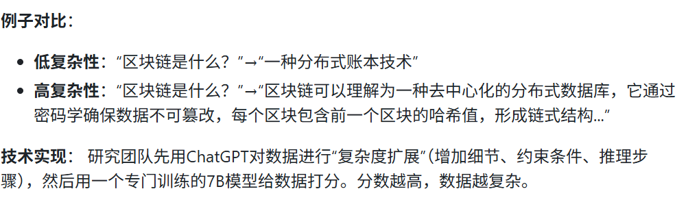
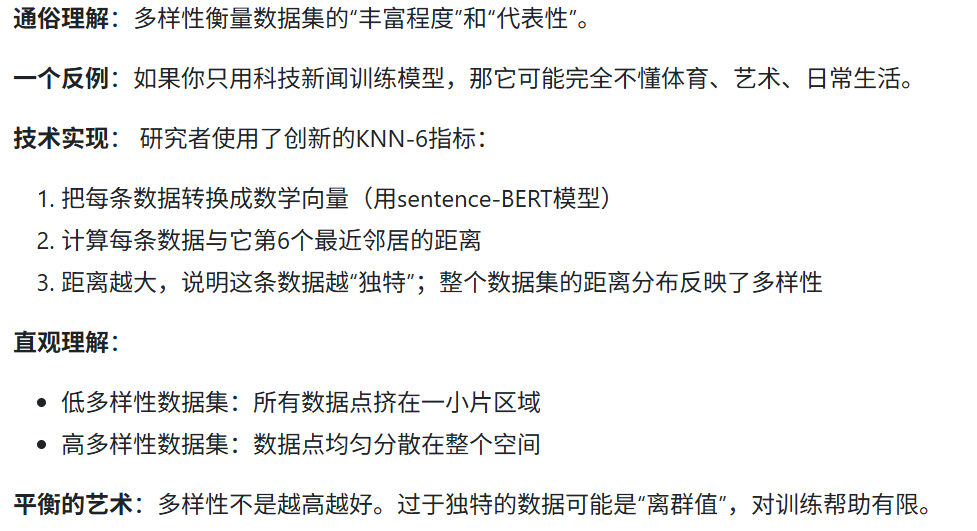
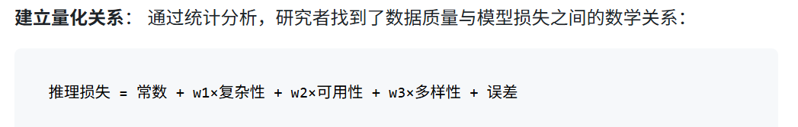
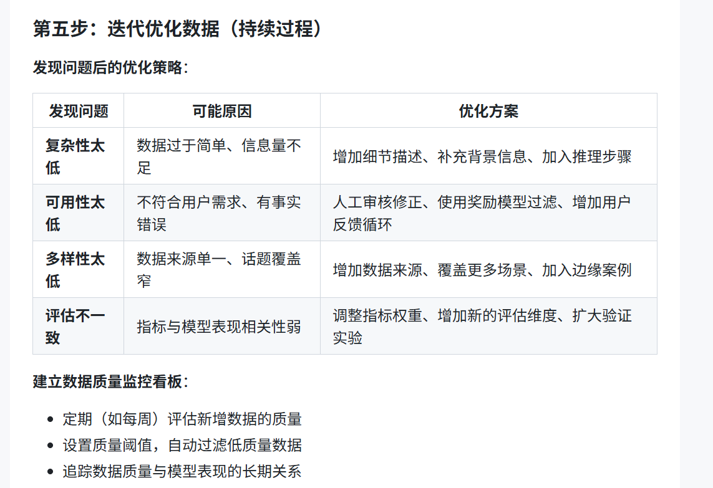
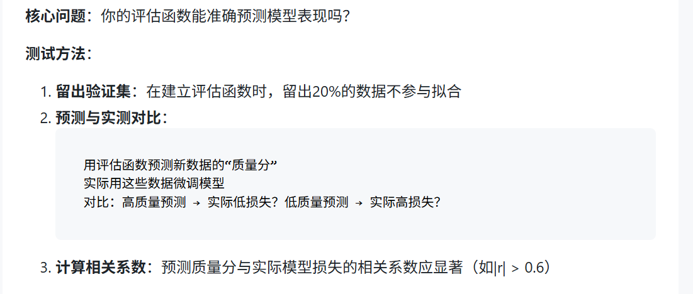
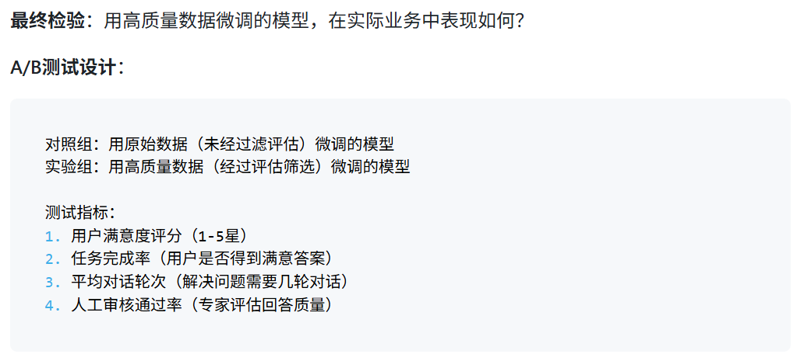
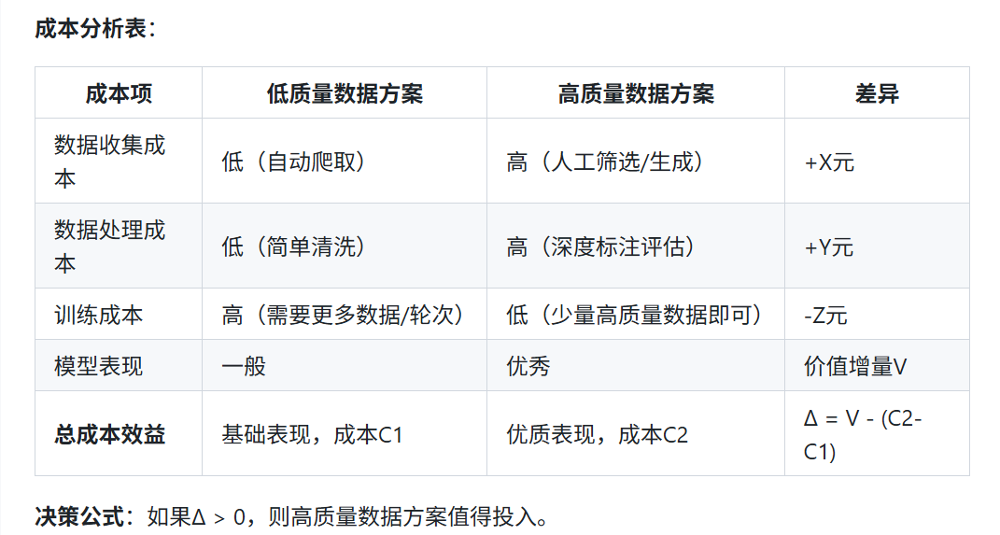
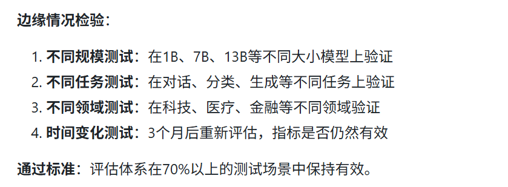

+++
date = '2026-09-10T19:27:56-05:00'
draft = true
title = '大模型微调数据质量评估指南'
+++

source: https://developer.volcengine.com/articles/7602479788368134171#heading19
### 技术原理：理解数据质量的三个黄金维度

**传统方法**
- 标签准确率（这张图是猫还是狗？）
- 数据完整性（所有字段都填了吗？）
- 格式一致性（日期都写成YYYY-MM-DD了吗？）

**核心问题**： 大语言模型微调的指令通常是问答式的，没有明确的对错标签

#### 维度一：复杂性--数据有足够的信息吗
**通俗理解**：复杂性衡量数据的“信息密度”和“思考深度”。

**作用**： 促使复杂的思考，而不是简单称述事实
**复杂性评估**：
- 如果有资源：使用研究中的“复杂度扩展+模型评分”方法
- 简易版：计算平均文本长度 + 人工标注复杂度等级

#### 维度二：可用性——数据符合人类偏好吗？
**通俗理解**：可用性衡量数据“对人有没有用”、“是不是人想要的”。
**核心问题**：大模型最终是为人服务的，所以训练数据应该符合人类的价值取向和偏好。
**技术实现**： 研究者使用了一个特殊的“奖励模型”。这个模型通过人类偏好数据训练，学会了给回答打分：
- 符合人类偏好的高质量回答 → 高分
- 低质量、有问题的回答 → 低分
**可用性评估**：
方法选择：
- 如果有资源：使用预训练的奖励模型（如oasst-rm-pythia-1.4b）
- 简易版：制定人工评估标准

简易版实施：
1. 制定评估标准（如：是否准确、是否有用、是否安全、是否易读）
2. 招募3-5名评估者（最好是目标用户代表）
3. 随机抽取200条数据，每条由至少2人评估
4. 计算平均得分和评估者一致性

#### 维度三：多样性——数据覆盖面够广吗？

**多样性评估**：
必需步骤（需要编程）：
1. 安装sentence-transformers库
2. 将所有数据的“指令+回答”转换为向量
3. 计算KNN-6指标

#### 核心理念
!!! 不直接定义“什么是好数据”，而是看“用了这些数据后，模型表现如何

1. 准备不同质量的数据子集
2. 分别用这些子集微调同一个基础模型
3. 测试微调后模型在标准测试集上的“推理损失”（预测错误程度）
4. 发现规律：好数据 → 低损失；差数据 → 高损失
#### 评估函数
抽出筛选好的数据集，抽出20个左右的子集进行训练，获取loss结果
再用loss结果进行多元线性回归与复杂性，可用性，多样性，来定制评估损失函数

#### 迭代优化数据

#### 效果评估：如何验证你的数据质量评估体系有效？
##### 验证维度一：预测准确性测试

##### 验证维度二：业务效果提升验证

时间周期： 1-2周
一定要统计显著性：使用t检验确认差异是否显著（p < 0.05）

##### 验证维度三：成本效益分析

##### 验证维度四：鲁棒性测试
