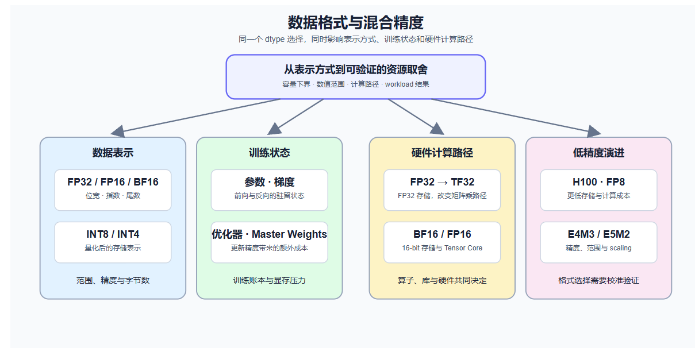

+++
date = '2026-09-13T12:22:44-05:00'
draft = true
title = '大模型的数据格式与混合精度'
tag = ['数值基础', '数据类型', '混合精度']
+++

**Source**: [DataWhale大模型的数据格式与混合精度]（https://github.com/datawhalechina/llm-algo-leetcode/blob/4fa62623ae7f2f207871b43c3f254a765765bf2e/01_Hardware_Math_and_Systems/01_Data_Types_and_Precision.ipynb）

