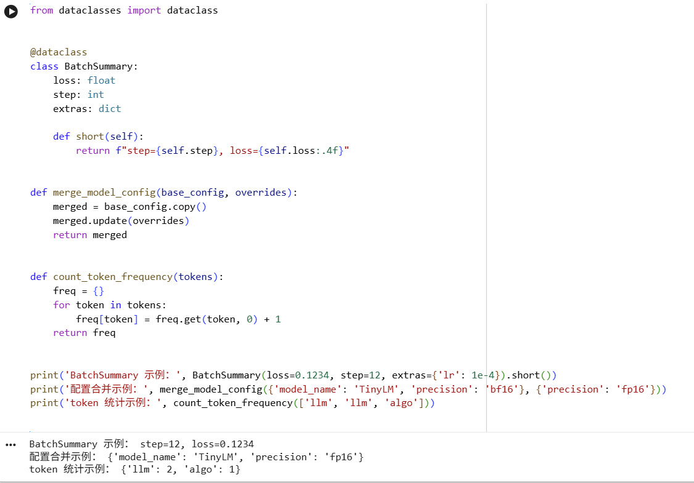
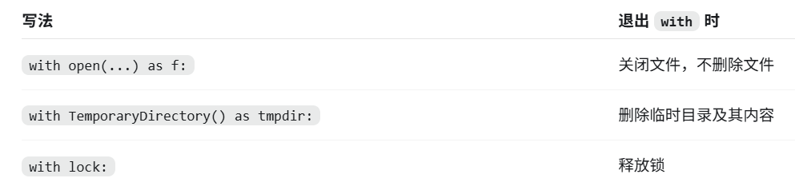
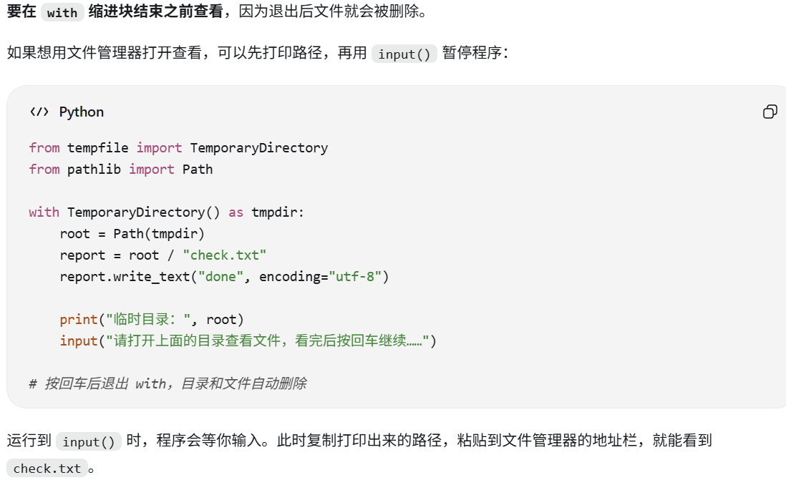

+++
date = '2026-09-13T12:04:18-05:00'
draft = false
title = '数据结构与工程表达'
tag = ['Python', '工程基础', '数据结构']
+++

source : [DataWhale Python 基础与数据表示 ](https://github.com/datawhalechina/llm-algo-leetcode/blob/main/00_Prerequisites/01_Python_Essentials_for_LLM.ipynb)

## Q1：list / dict / class / with 各自负责什么？**



!!!!! **list 装顺序数据，dict 装命名状态，class 装可复用对象，with 管资源收尾。**

#### Class 讨论

```
from dataclasses import dataclass

@dataclass
class BatchSummary:
    loss: float
    step: int
    extras: dict

    def short(self):
        return f"step={self.step}, loss={self.loss:.4f}"
        
```

`BatchSummary`: 是一个封装的类用于描述某一批次或者某一步训练的情况
-  loss: 损失值，用于衡量模型的预测误差
- step: 当前训练的步数
- extra: 额外的信息
---------------------------
```
def merge_model_config(base_config, overrides):
    merged = base_config.copy()
    merged.update(overrides)
    return merged
```
`merge_model_config`：用新设置覆盖默认配置; update() 的规则是：同名键覆盖，不存在的键新增。
------------------------------
##### 什么时候该用 with 管资源？
当你只是临时检查输出、保存中间结果或做一次性调试时，临时目录比手动创建和清理目录更稳，也更不容易残留脏文件。后面做预处理缓存、日志和 checkpoint 这类事情时，这个习惯会直接用上。
```
from pathlib import Path
from tempfile import TemporaryDirectory

with TemporaryDirectory() as tmpdir:
    root = Path(tmpdir)
    report = root / 'report.txt'
    report.write_text('hello io', encoding='utf-8')
    print('临时文件路径：', report)
    print('临时文件内容：', report.read_text(encoding='utf-8'))
print('✅ with 收尾完成')
```

##### 临时目录是否自动收尾？
```
with TemporaryDirectory() as tmpdir:  # 创建临时目录
    root = Path(tmpdir)
    report = root / "check.txt"
    report.write_text("done", encoding="utf-8")

    # 在 with 内，目录和文件都存在

# 离开 with，临时目录和 check.txt 自动被删除
```
**TemporaryDirectory()**，它自带“退出时删除临时目录”的功能。with 会在退出缩进块时触发这个清理功能，目录及其中的文件都会被删除。


##### 如何查看临时目录的内容
